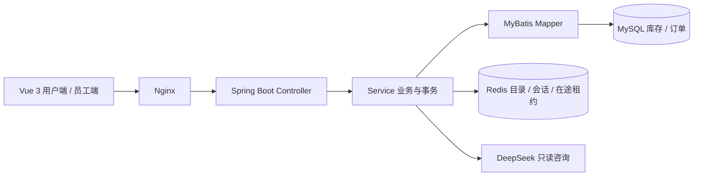

# 龙院摄影器材 · 租赁预约与咨询系统

基于 Spring Boot、MyBatis、MySQL、Redis 和 Vue 3 的单门店器材租赁项目。客户选择租期并预约，员工确认、交付及验收归还；小影接入 DeepSeek，结合门店规则与公开器材目录提供咨询和推荐链接。

这是从苍穹外卖学习项目演进的租赁业务实现，保留真实 Git 历史及旧接口。演示器材、价格均为测试资料。当前交付是网页版；没有上线运营、线上支付、小程序或原生 App，不虚构订单量和性能提升。

## 可以演示的功能

- 用户注册、登录、个人信息与头像上传；用户/员工角色和订单归属校验。
- 型号、分类、独立实物及 READY/MAINTENANCE/RETIRED 状态管理。
- 按 `[领取日,归还日)` 报价；事务内分配实物，统一行锁顺序避免同一实物重复预约。
- 用户级 requestId 幂等校验；待确认、确认、领取、归还、取消、拒绝和事件记录。
- 逾期未归还实物停止新预约，并阻止下一位客户提前领取。
- 公开目录 Redis 短缓存、提交后版本失效、CAS 防旧数据回填；库存与金额由数据库实时计算。
- 小影的规则/本人订单查询、真实模型咨询、Redis 会话，以及后端核验的器材名称跳转。
- 收藏、完成订单后的单次评价；电脑管理端与含底部导航的响应式用户网页。

## 架构

租赁代码位于 `com.sky.rental`。缓存不参与库存分配，模型不执行预约、取消或支付。管理员新账号支持 BCrypt，原员工 MD5 密码保留兼容；客户密码使用 BCrypt。

## 运行与验证

推荐 JDK 17、Maven 3、Node.js 22、MySQL 8、Redis；后端以 Java 8 API 兼容模式构建。

1. 按 [运行说明](docs/rental/RUNBOOK.md) 配置数据库、Redis、初始化新增表。真实配置放进环境变量或被忽略的 `.rental/application-local.yml`，不写入仓库。
2. `mvn -Dmaven.compiler.release=8 package`；设置 `SKY_DB_INTEGRATION=true`、`SKY_REDIS_INTEGRATION=true` 可运行真实依赖测试。
3. 在 `frontend/rental-web` 执行 `npm ci`、`npm test`、`npm run build`。
4. Windows 本机可用 `./scripts/Start-RentalLocal.ps1 -UseIdeaRedisConfiguration` 启动：用户端 `http://localhost:8082/`，员工端 `http://localhost:8082/admin/login`。
5. 对本机运行 `node scripts/Verify-Rental.mjs` 可重做完整 HTTP 验收和有限规模性能测试；加 `--model` 才会触发一次真实模型调用，需本机已配置密钥。

没有公开默认管理员密码。全新数据库的管理员通过独立 bootstrap 启动方式创建，见 [部署说明](docs/rental/PRODUCTION.md)。

## 交付资料

- [接口契约](docs/rental/API.md) · [开发交接](docs/rental/DEVELOPMENT.md)
- [验收结果与边界](docs/rental/VALIDATION.md) · [性能样本与复现方法](docs/rental/PERFORMANCE.md)
- [演示步骤](docs/rental/DEMO.md) · [简历描述与面试复盘](docs/rental/RESUME-INTERVIEW.md)
- [生产部署、备份与回退](docs/rental/PRODUCTION.md) · [小影配置](docs/rental/ASSISTANT.md)

本地端到端 HTTP、DOM 交互和数据库测试分别验证不同层面；它们不能代替手机真机或公网验收。最新已执行项目及未执行项统一记录在验收文档中。
